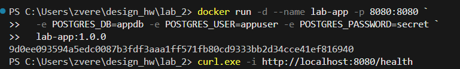
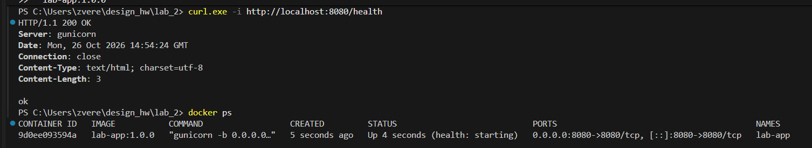
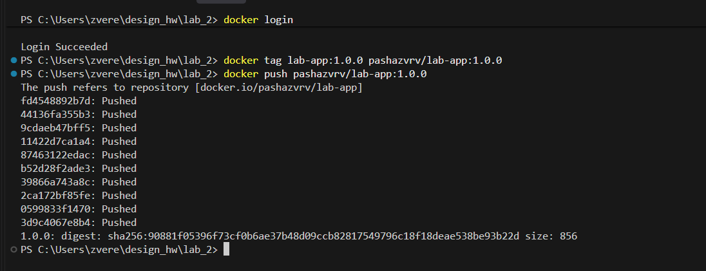
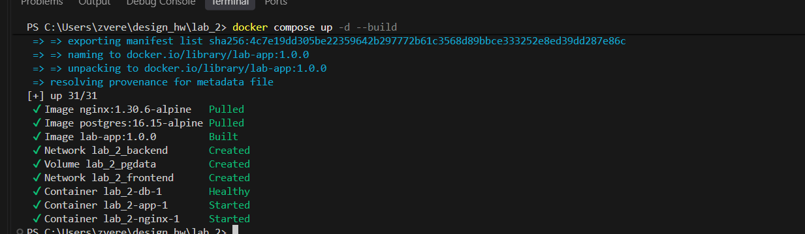
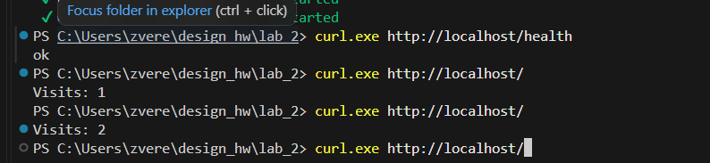
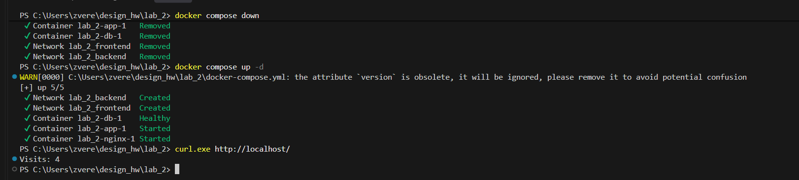

 Flask-приложение: `GET /health`,`GET /` - увеличивает счётчик посещений в PostgreSQL и показывает его.


## Часть 1.


Образ: `pashazvrv/lab-app:1.0.0`

```bash
docker run -d --name lab-app -p 8080:8080 \
  -e POSTGRES_DB=appdb -e POSTGRES_USER=appuser -e POSTGRES_PASSWORD=secret \
  pashazvrv/lab-app:1.0.0
```


### Проверка

Проверка:

```bash
curl -i http://localhost:8080/health       
docker ps                                   
docker exec lab-app id                      
```
](images/image.png)

](images/image-4.png)



## Часть 2


Проверка:

```bash
docker compose up -d --build
curl http://localhost/health  # ok
curl http://localhost/        # Visits: 1, затем 2, 3 ...
```

Данные сохраняются между перезапусками:

```bash
docker compose down         
docker compose up -d
curl http://localhost/       
```


## Скриншоты 






Данные переживают перезапуск: 

