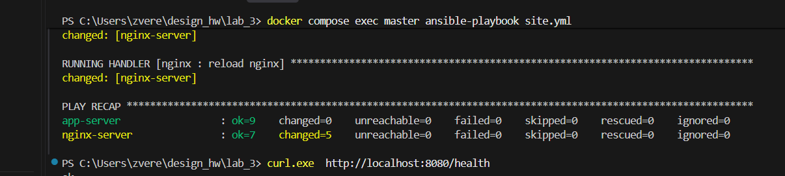

Через Ansible разворачиваем nginx и Flask-приложение на двух контейнерах.


## Структура

```
lab_3/
├── docker-compose.yml
├── docker/
│   ├── master/Dockerfile        # ubuntu + ansible + sshpass
│   └── node/Dockerfile          # ubuntu + sshd + python3 ("чистая машина")
└── ansible/
    ├── ansible.cfg
    ├── inventory.ini            # хосты nginx-server и app-server
    ├── site.yml                 # плейбук: роль app, затем роль nginx
    └── roles/
        ├── app/                 # проверки, зависимости, код, start.sh, запуск
        │   └── files/           # исходники приложения: app.py, requirements.txt, start.sh
        └── nginx/               # установка, конфиг reverse proxy, запуск
```


## Запуск

Нужен Docker с Docker Compose.

```bash
docker compose up
docker compose exec master ansible-playbook site.yml   # развернуть всё
```

## Проверка

```bash
docker compose ps                    
curl http://localhost:8080/health   
curl http://localhost:8080/ 
```


## Скриншоты

Статус контейнеров и результат `ansible-playbook`:




Работа приложения через nginx:


